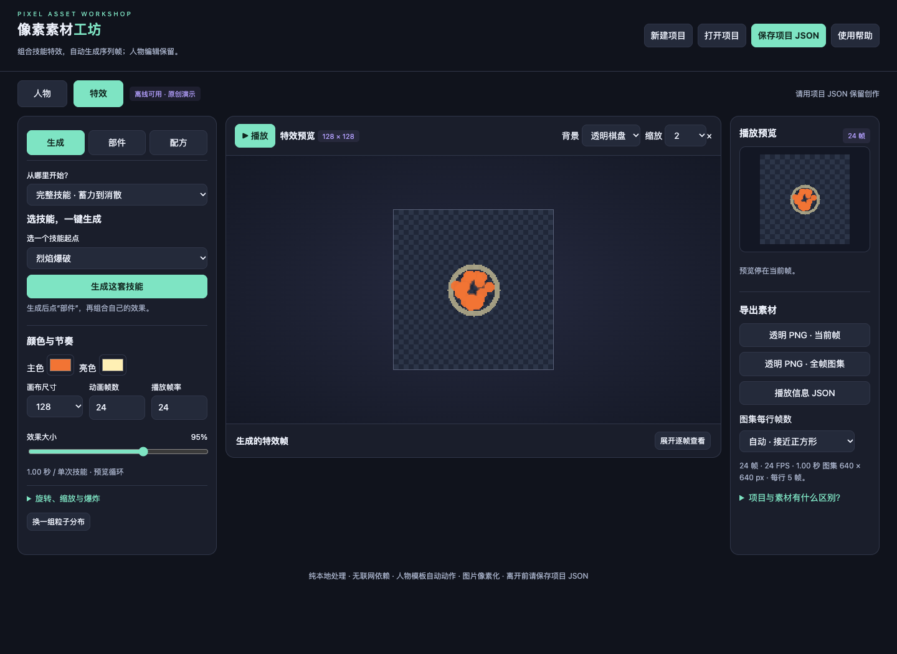
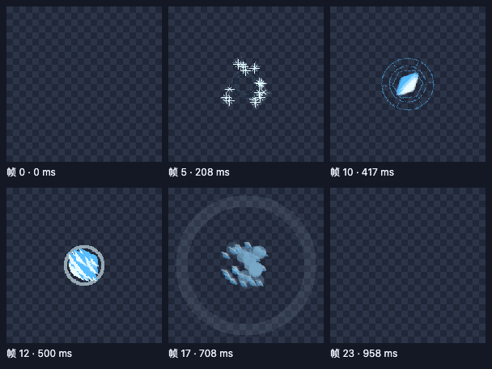

# Pixel Asset Workshop

[简体中文](README.zh-CN.md) · [Usage guide (中文)](docs/guide.zh-CN.md) · [Agent guide (中文)](docs/agents.zh-CN.md) · [MIT](LICENSE)

A local, offline workshop for pixel characters, baked sprite animations and
procedural 2D skill effects. Open one HTML file to edit; use structured JSON
requests through the CLI or a local stdio MCP server to automate effect creation.





## Start in a browser

Download this repository and open **index.html** in desktop Chrome or Edge.
The editor needs no account, API key, installation, server or network connection.
The current UI and detailed guides are in Simplified Chinese.
**Save your project JSON before closing or refreshing: there is no autosave.**

## What it does

- Pixel characters: 32–512 px canvases, layers, frame duplication, onion skin,
  transparent PNG import and baked animation export.
- Character rigging: 17 joints, two-bone leg IK, arm chains, wrist-following
  weapons and image skinning, with idle/walk/run/attack actions.
- Skill effects: five procedural starting templates (fire, ice, lightning,
  healing, wind), up to six composited modules, timing, scale, rotation,
  easing, additive blending and imported PNG strips.
- Delivery: transparent PNG sheets and frames, playback JSON, editable project
  JSON and reusable effect recipes. Agent exports also include a contact preview.
- Automation: stable module IDs, JSON Schema, validation, frame-boundary
  diagnostics, non-overwriting outputs and optional MCP image previews.

## CLI quick start

Install **Node.js 22+** and **Chrome/Chromium** separately. No npm dependencies.

```sh
git clone https://github.com/956005596/pixel-asset-workshop.git
cd pixel-asset-workshop
node cli.mjs doctor
node cli.mjs run --request examples/ice-burst.json --out outputs/ice-burst
```

The result is JSON with projectPath, previewPath, sheetPath and diagnostics.
An existing output directory is rejected: choose a new path for each revision.
Input paths resolve relative to the request file; output paths resolve relative
to the working directory. stdin/MCP input paths use the working directory.
Set PIXEL_WORKSHOP_BROWSER to a browser executable if discovery fails.

```sh
node cli.mjs describe
node cli.mjs inspect --project outputs/ice-burst/ice-burst-项目.json
node cli.mjs preview --project outputs/ice-burst/ice-burst-项目.json --out outputs/preview.png
npm run check
npm test
```

## Local MCP integration

Configure a client that supports local stdio MCP, replacing the example paths:

```json
{
  "mcpServers": {
    "pixel-workshop": {
      "command": "/absolute/path/to/node",
      "args": ["/absolute/path/to/pixel-asset-workshop/mcp-server.mjs"]
    }
  }
}
```

Tools: pixel_workshop_describe, pixel_workshop_render,
pixel_workshop_inspect, pixel_workshop_preview. The server does not register
itself or modify client settings. It can read explicitly supplied local PNG/JSON
files and writes exports to the chosen local directory. Use a trusted local client.
The CLI launches an isolated temporary browser with offline rendering enabled.

## Current limits

This is an early public release of a personal game-asset tool. No public adoption
or download claims are made. Character automation currently uses the browser UI;
the dedicated CLI/MCP editing API covers effects and preserves character data.
Rigging exports baked frames, not an engine runtime rig. A single image cannot
reveal hidden body parts or create a new camera angle; joints, masks and occlusion
need manual adjustment. Enlarging a template does not create new detail.

Effects support 4–32 frames and 1–30 FPS; canvases support up to 512 px. Imported
effect cells are normalized to at most 64 px and at most 16 source frames.
No online image generation, natural-language parser, GIF/APNG export or automatic
game-engine integration is included. Final animation quality, touch interaction,
Windows/Linux browser launch and game-engine integration need separate validation.
Automated checks verify mechanisms; they do not establish artistic acceptance.

## Project layout and contribution

- index.html: complete browser application and source of truth; no build step.
- cli.mjs / mcp-server.mjs: local automation entry points.
- agent-contract.json: request schema, limits and API capabilities.
- examples/: reproducible procedural request; docs/: usage and preview.
- tests/: isolated smoke checks; scripts/: syntax and contract utilities.

See [CONTRIBUTING.md](CONTRIBUTING.md), [source/asset provenance](THIRD_PARTY_NOTICES.md)
and [release notes](CHANGELOG.md). Report reproducible issues or send focused PRs.

MIT-licensed software. Imported artwork keeps its original rights.
